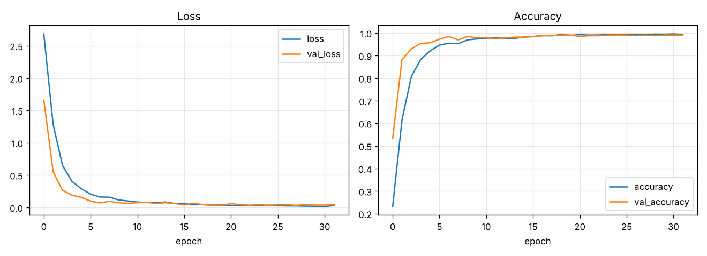
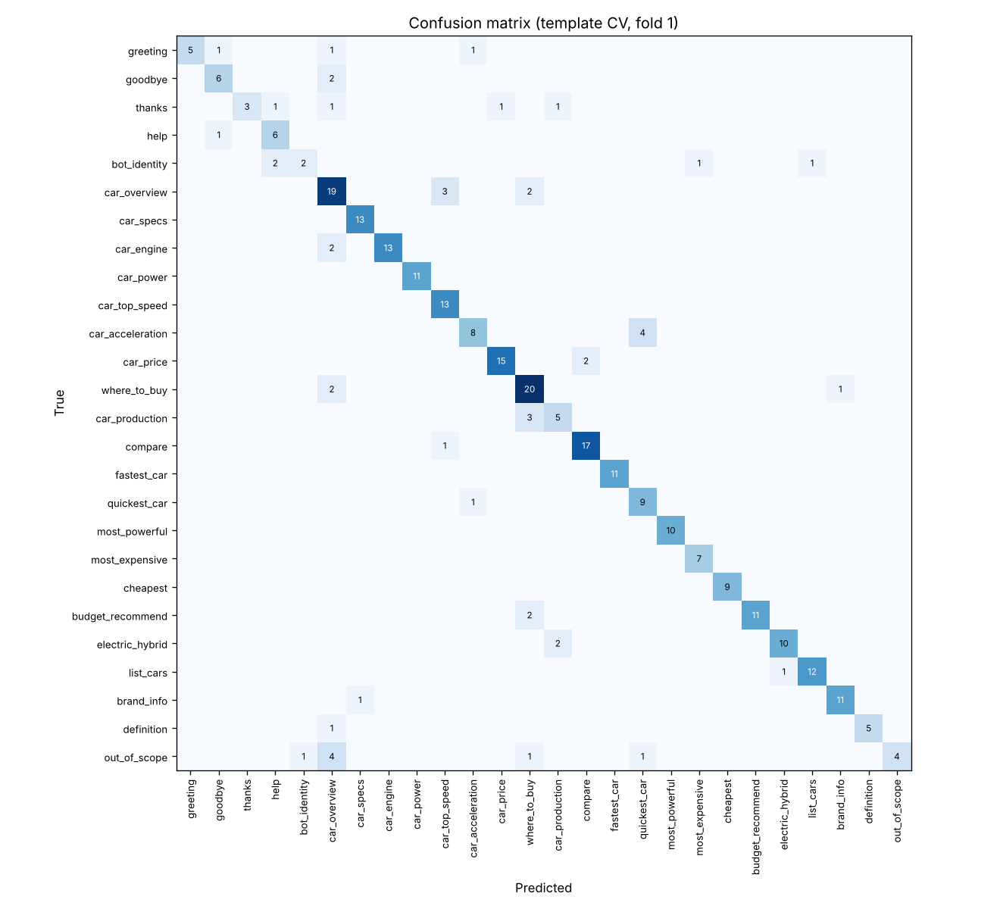
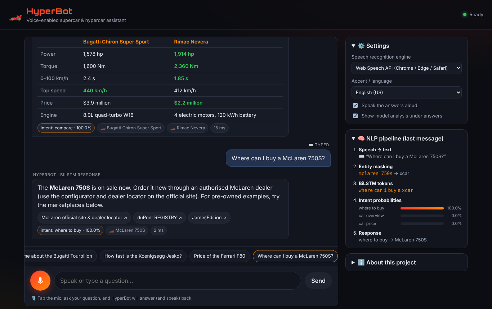

# Project Report: HyperBot, a Voice-Enabled Supercar & Hypercar Chatbot

**Live application:** https://kanavbh29.github.io/slp/
**Source code:** https://github.com/KanavBh29/slp

## 1. Objective

Build and deploy a public web chatbot that:

1. takes a **spoken** question,
2. converts the speech to text with a **speech recognition** engine,
3. understands the text with a **deep learning** intent classifier,
4. answers about supercars and hypercars (details, specifications, price, where to buy), and
5. shows both the recognised speech and the response.

## 2. System overview

```
Microphone ─► ASR (Web Speech API or in-browser Whisper) ─► transcript (+ n-best, confidence)
          ─► normalisation ─► entity extraction (car / brand / budget; exact + fuzzy + phonetic)
          ─► delexicalised sentence, e.g. "how fast is the xcar"
          ─► GloVe-initialised BiLSTM intent classifier (26 intents, softmax)
          ─► dialogue manager (confidence threshold, context memory, slot filling)
          ─► response from the car knowledge base ─► chat UI + text-to-speech
```

Everything runs **client-side**. The trained Keras network is exported to a compact binary file, and a hand-written JavaScript forward pass runs it in the browser. Hosting is therefore a free static site (GitHub Pages) with no backend, no API keys and no cold starts. Inference takes a few milliseconds.

## 3. Speech recognition

| Engine | Technique | Where it runs | Notes |
|---|---|---|---|
| **Web Speech API** (default) | The browser vendor's neural ASR (Chrome/Edge use Google's deep-learning speech service) | Browser + vendor cloud | Streaming interim results, n-best list (3 alternatives) with confidence scores. Supports en-US/GB/IN/AU accents. |
| **Whisper-tiny.en** (optional) | Transformer encoder-decoder (OpenAI Whisper, 39M parameters), run through ONNX Runtime Web via Transformers.js | Entirely in the browser | Works in browsers without Web Speech (Firefox). Push-to-talk; audio is resampled to 16 kHz mono before transcription. |

Car names are a hard case for general-purpose ASR. "Chiron" often comes out as *"sheeran"*, "Huayra" as *"wire a"*, and "Nevera" as *"never a"*. Three things make the system robust to this:

* **n-best rescoring:** if the top transcript has no known car but a lower-ranked alternative does, that alternative is used.
* **Fuzzy matching:** windows of 1–3 words are compared with every alias by normalised Levenshtein similarity (≥ 0.8). Only windows with at least one uncommon word are tried, which avoids false hits on ordinary words.
* **Phonetic matching:** a simplified Metaphone key (`sheeran`→`xrn` = `chiron`→`xrn`; `hurricane`→`hrkn` = `huracan`→`hrkn`) catches mishearings that are spelled differently but sound alike.

## 4. Dataset

### 4.1 Intent corpus (`training/intents.py`)

There is no public dataset for supercar-assistant intents, so I wrote a domain corpus by hand:

* **26 intents**: greeting, goodbye, thanks, help, bot_identity, car_overview, car_specs, car_engine, car_power, car_top_speed, car_acceleration, car_price, where_to_buy, car_production, compare, fastest_car, quickest_car, most_powerful, most_expensive, cheapest, budget_recommend, electric_hybrid, list_cars, brand_info, definition, out_of_scope.
* **796 utterance templates** (19–54 per intent). These include short elliptical follow-ups ("how much does it cost"), ASR-style unpunctuated text, and an `out_of_scope` class (weather, jokes, homework…) so the bot can decline off-topic questions.
* **Slot placeholders**: `{car}`, `{car2}`, `{brand}`, `{num}`.

**Delexicalisation (slot masking).** Placeholders become the tokens `xcar`, `xbrand` and `xnum`. At inference time, recognised entities are replaced by the same tokens. The network therefore learns *what is being asked*, not 35 car names, and new cars can be added to the database without retraining.

**Data augmentation** (12 variants per template):

* Random polite prefixes and suffixes ("hey …", "… please").
* *Unknown-entity simulation*: in 12% of cases the car slot is filled with out-of-vocabulary tokens, which mimics an unrecognised or misheard car name.
* *ASR word-dropout*: with probability 0.15, one non-entity word is deleted, which simulates recognition errors.

This produces **4,158 training sentences** for the final model.

### 4.2 Knowledge base (`web/data/cars.json`)

* **35 cars from 18 manufacturers**: 21 hypercars and 14 supercars, including 2 fully electric and 17 hybrid models. Examples: Bugatti Tourbillon, Koenigsegg Jesko Absolut, Rimac Nevera, Ferrari F80, McLaren W1, Aston Martin Valkyrie, Porsche 918 Spyder, Lamborghini Revuelto and Corvette ZR1.
* Fields: engine, power (hp), torque (Nm), 0–100 km/h, top speed, approximate price (USD), production volume, availability status, description, and aliases (including common mishearings).
* **Where to buy** depends on the car's status:
  * *available*: the official dealer and configurator.
  * *limited*: the manufacturer, plus the secondary market.
  * *sold out* or *discontinued*: specialist marketplaces (duPont REGISTRY, JamesEdition) and auction houses (Bring a Trailer, RM Sotheby's).

Specs are manufacturer claims. Prices are approximate US base prices for new cars, or typical market values for sold-out and discontinued cars.

## 5. Model architecture

```
Input: 24 token ids (post-padded, 0 = padding, 1 = OOV)
  │
  ├─ Embedding 8,116 × 50, initialised with GloVe (glove-wiki-gigaword-50), mask_zero, fine-tuned
  ├─ Bidirectional LSTM, 64 units per direction → 128-d sentence vector
  ├─ Dropout 0.3
  ├─ Dense 64, ReLU
  ├─ Dropout 0.3
  └─ Dense 26, softmax
Total parameters: 474,626 (≈ 406k embedding, 59k BiLSTM, 10k dense)
```

* **Why a BiLSTM:** intent depends on word order and context ("is the *xcar* faster than the *xcar*" versus "fastest car"). A bidirectional LSTM reads the sentence both ways and handles variable-length sentences through masking.
* **Why GloVe transfer learning:** the vocabulary contains every training word plus the 8,000 most frequent English words, all initialised with pre-trained GloVe vectors (400k-word Wikipedia + Gigaword model). Rows for words that never occur in training receive no gradient, so they keep their GloVe meaning. As a result the model copes with words that never appear in the training templates. For example, *"where can I **acquire** one"* → where_to_buy, *"how many were **manufactured**"* → car_production, and *"which **vehicles** are battery electric"* → electric_hybrid (each ≈100%). Words outside the 8,116-word vocabulary map to the OOV token.
* **Placeholder vectors:** `xcar`, `xbrand` and `xnum` start from the GloVe vectors of "supercar", "manufacturer" and "million".
* **Browser export:** embeddings are quantised to int8 with a per-row scale, and the other weights stay float32. The model downloads as 0.7 MB of weights plus an 80 KB vocabulary. The JavaScript implementation of the masked BiLSTM (Keras gate order i, f, c, o) matches Keras within **5 × 10⁻⁷** on reference sentences (`tests/parity.test.mjs`).

**Training:** Adam (lr 2e-3), sparse categorical cross-entropy, batch size 32, up to 80 epochs, early stopping on validation loss (patience 12, best weights restored), 10% validation split. Seed 42.

## 6. Dialogue management

* **Confidence threshold (0.5):** below it, rule-based fallbacks use the extracted entities (two cars → compare, one car → overview, a budget → recommendation); otherwise the bot asks the user to rephrase.
* **Context memory:** the last mentioned cars are remembered, so "how fast is it?", "price please" and "compare it with the Jesko" work. Context is reused only for real follow-ups (a pronoun or a very short question). *"What is the price of the Tesla Roadster?"* gets "I don't have that car" instead of a wrong answer.
* **Slot filling:** "Recommend me a car" → "What is your budget?" → "500 thousand" → recommendations.
* **Rankings and filters:** fastest, quickest, most powerful, most expensive and cheapest, optionally per brand ("most powerful Ferrari"), plus electric/hybrid lists and budget search.

## 7. Results

### 7.1 Intent classification

Two evaluation protocols, each comparing three neural models. All three use the same data and early stopping.

* **Random split (in-distribution):** 85/15 split of the generated sentences. Test sentences can share a template with training sentences.
* **Template 5-fold cross-validation (generalisation):** in each fold, 20% of *every intent's templates* are held out. Every test sentence is therefore a phrasing the model has never seen. This is the more honest estimate of how well the model handles new user wordings.

| Model | Trainable params | Random split: accuracy | Random split: macro-F1 | **Template 5-fold CV: accuracy** | **Template 5-fold CV: macro-F1** |
|---|---|---|---|---|---|
| Bag-of-words MLP (baseline, ignores word order) | 1.04 M | **97.1%** | **0.930** | 80.6% ± 1.1 | 0.789 ± 0.028 |
| BiLSTM, embeddings learned from scratch | 0.47 M | 94.9% | 0.910 | 77.0% ± 1.3 | 0.740 ± 0.009 |
| **BiLSTM + GloVe transfer learning (deployed)** | 0.47 M | 95.4% | 0.918 | **81.5% ± 3.3** | **0.792 ± 0.044** |

Random split: 3,547 train / 626 test sentences. Template CV: about 3,240 train / 300 test sentences per fold. The deployed model is then retrained on all 796 templates (4,158 sentences) and reaches **98.8% validation accuracy**.

Per-intent F1 (fold 1) and the confusion matrix are in `training/artifacts/metrics.json` and `confusion_matrix.png`. Training curves are in `training_curves.png`.




**Findings**

* **Transfer learning matters most for unseen phrasings.** Initialising the BiLSTM with GloVe adds **+4.5 accuracy points** and **+0.05 macro-F1** over the same network trained from scratch, because synonyms the model never saw in training already have meaningful vectors.
* **On the in-distribution split, all models score 95–97%.** The bag-of-words MLP is slightly ahead there because the test sentences reuse training templates, and keyword memorisation works well in that setting.
* **On genuinely new phrasings, the GloVe-BiLSTM has the best mean accuracy and F1.** It is also less than half the size of the bag-of-words MLP. Its fold-to-fold variance is higher (± 3.3 points), so the gap to the baseline is within noise. An honest summary: the two are comparable on accuracy, while the BiLSTM additionally models word order and is smaller to ship.
* **Common errors:**
  * one-word slang the model has no vector for ("thx", "cya", "yo" → car_overview);
  * off-topic questions shaped like "who/what is X" ("who are the beatles" → car_overview);
  * acceleration of one car vs the acceleration ranking ("zero to sixty" → quickest_car);
  * "is it sold out" → where_to_buy.

  In the running app the dialogue manager reduces several of these. For example, a car-specific intent with no car mentioned asks *"Which car do you mean?"* or says the car is not in the database, rather than guessing.

### 7.2 End-to-end tests

`npm test` runs on every deployment (GitHub Actions):

| Test | Result |
|---|---|
| JS BiLSTM vs Keras on 11 reference sentences | identical labels, max probability difference 5 × 10⁻⁷ |
| Python vs JS tokenizer on 13 tricky inputs | identical |
| Entity extraction (11 cases incl. "bugatti sheeran", "koenig seg jesko", "rimac never a") | all correct |
| Budget parser ("$300k", "2.5 million dollars", "two million", "half a million", "3 crore rupees") | all correct |
| 32-turn scripted conversation with follow-ups, comparisons, slot filling and out-of-scope questions | 32 / 32 correct intents and entities |

I also tested the deployed page in headless Chromium at desktop and mobile widths, with a simulated microphone that returns *"how fast is the bugatti sheeran"*. The page shows the recognised speech (91% ASR confidence) and answers *"The Bugatti Chiron Super Sport has a top speed of 440 km/h (273 mph)"*, with no console errors.



## 8. Limitations and future work

* The intent corpus is hand-written and synthetic. Logging real (anonymised) user queries and retraining would improve robustness the most.
* Web Speech API quality and privacy depend on the browser vendor (Chrome sends audio to Google). The Whisper engine keeps audio on the device but needs a ~40 MB one-time download.
* Prices and availability change. The knowledge base is a static JSON file and should be refreshed periodically or connected to a live listings API.
* Possible extensions: a transformer encoder (e.g. DistilBERT) fine-tuned for intents, joint intent + slot tagging (BiLSTM-CRF) instead of dictionary matching, and multilingual ASR.

## 9. How to reproduce

```bash
pip install -r training/requirements.txt
python3 training/train.py        # trains, evaluates, writes web/model/* and training/artifacts/*
npm test                         # parity, entity and conversation tests
python3 -m http.server 8000 --directory web
```
